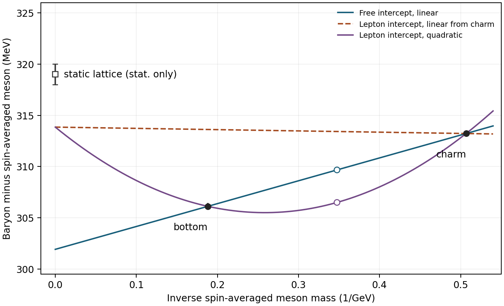

# Where 313 MeV comes from

*Research note, 27 November 2026*

The charmed-baryon subtraction $M_{\Lambda_c}-(M_D+3M_{D^*})/4$ gives **313.224 MeV** with isospin-averaged 2026 masses. Replacing charm by bottom gives **306.116 MeV**. Giving the light baryon octet and decuplet one vote per isospin family also gives about 313–314 MeV. Giving every charge state one vote gives **230.914 MeV**. The first subtraction measures the change in the energy of light QCD fields around a heavy colour source. The second number includes an 83.191 MeV shift from the chosen flavour weights. These two controls place the proposed connection to the **313.850 MeV** charged-lepton normalization on a quantitative footing. [Francis et al., table 1 and appendix A](https://arxiv.org/pdf/2106.09080#page=11) · [Copeland, Ji and Melnitchouk, §II](https://arxiv.org/pdf/2112.03198#page=2)

There are three further questions. Does the hypercharge scale of the weak bosons determine the lepton normalization? Can that normalization fix the inverse down-quark seesaw? Does the mass of an actual helium nucleus supply an independent hadronic unit? Each question admits a numerical test. In particular, the seesaw comparison involves a second scale near **92 MeV**, and dividing the free four-nucleon mass by twelve gives the nucleon benchmark identically. The iron–nickel construction supplies a more restrictive nuclear hypothesis with a measurable charm ceiling. [Inverse-Koide scale study](INVERSE-KOIDE-SCALE.md) · [Alphaology](https://explaining-alphaology.al-rivero.chatgpt.site/) · [Public nuclear analysis](https://github.com/arivero/chatpublic/blob/06dd210e29ee38f5a2c20346623db1ed6a7aebae/discussions/2026-11-12-nuclear-particle-mass-scales/notes/iron_nickel_charm.md)

**Reading route.** Sections 1–3 derive the spectroscopy. Sections 4–6 treat electroweak matching, the inverse seesaw and the other published appearances of 313–314 MeV. Sections 7–9 develop the nuclear tests and the proposed mechanisms. The last section identifies the inputs and measurements that can still decide between them. Two offline calculations accompany the note. Numerical values quoted from lattice fits are identified as such. [Spectroscopy and flavour calculator](../scripts/verify_313_scale.py) · [Nuclear calculator](../scripts/verify_313_nuclear.py) · [Input tables and reproduction instructions](../sources/313-mev/README.md)

## 1. Three normalizations

Use $\hbar=c=1$. Take pole masses for stable particles and the specified tabulated line-shape parameters for resonances. With the 2026 PDG charged-lepton and weak inputs and CODATA 2022 nucleons,

| Quantity | Definition | MeV |
|---|---|---:|
| Hadronic benchmark $H_N$ | $(m_p+m_n)/6$ | 312.972919 |
| Lepton sum normalization $A_\ell$ | $(m_e+m_\mu+m_\tau)/6$ | 313.849896 |
| Lepton root normalization $C_\ell$ | $(\sqrt{m_e}+\sqrt{m_\mu}+\sqrt{m_\tau})^2/9$ | 313.850933 |
| Electroweak proxy $E_\alpha$ | $\alpha(0)\sqrt{M_Z^2-M_W^2}$ | 314.472862 |

The first two numbers differ by 0.876977 MeV, or 0.2802%. Multiplying by six gives the underlying observation, $m_e+m_\mu+m_\tau-(m_p+m_n)=5.26186$ MeV. Mac Gregor explicitly used a 313 MeV nucleon subunit in 1974, with a corresponding Compton length $\hbar c/H_N\simeq0.6305$ fm. The division by three counts valence labels. Sea quarks, gluons and binding enter the measured nucleon masses. An isolated light-quark pole mass is a different object. [Mac Gregor, p. 1264](https://doi.org/10.1103/PhysRevD.9.1259) · [CODATA masses](https://physics.nist.gov/cuu/pdf/all.pdf) · [PDG leptons](https://pdg.lbl.gov/2026/tables/rpp2026-sum-leptons.pdf)

In the convention $K(m)=\sum m_i/(\sum\sqrt{m_i})^2$, $A_\ell/C_\ell=3K/2=0.999996695$. Exact Koide is $K=2/3$. It makes the two lepton normalizations equal. The positive-root parametrization $\sqrt{m_k}=\sqrt A[1+\sqrt2\cos(\delta+2\pi k/3)]$ then gives $\sum m_k=6A$. Rescaling all masses preserves $K$ and $\delta$ and changes $A$. A value for $A$ must come from additional physics. The repository's older symbol $\mathcal Q$ is $1/K$. [Lepton normalization and phase](https://explaining-alphaology.al-rivero.chatgpt.site/shape/#normalization) · [Koide's original model](https://doi.org/10.1007/BF02817096)

## 2. The heavy spectator test

For a spectator $Q=c,b$ define the isospin-averaged pseudoscalar and vector meson masses $P_Q,V_Q$, their spin mean $\bar M_Q=(P_Q+3V_Q)/4$ and $\Delta_Q=M_{\Lambda_Q}-\bar M_Q$. In the meson the light degrees of freedom have $j_\ell=1/2$. Coupling them to spin $1/2$ of the heavy quark gives $\langle\mathbf S_Q\cdot\mathbf j_\ell\rangle=-3/4,+1/4$ at $J=0,1$. Their multiplicities are one and three, so the chromomagnetic term cancels through first order in the heavy-mass expansion. The $ud$ pair in the ground-state $\Lambda_Q$ has $I=j_\ell=0$. Its light degrees of freedom and the meson's light antiquark both transform as colour $\bar{\mathbf{3}}$. The subtraction thus compares two colour singlets with the same heavy source. In a common heavy-quark mass scheme one obtains

$$
\Delta_Q=\bar\Lambda_{ud}-\bar\Lambda_{\bar q}
+\frac{\mu_{\pi,ud}^{\,2}-\mu_{\pi,\bar q}^{\,2}}{2m_Q}
+O(\Lambda_{\mathrm{QCD}}^3/m_Q^2).
$$

The leading heavy mass cancels. The residual light-field energy includes the attraction of a spin-zero $ud$ pair, spin-independent binding and gluon energy. Heavy-flavour symmetry constrains its limit. QCD dynamics supplies its value. The measured construction and the older extension to strange and light spectators give the following comparison in MeV. For $u/d$ the baryon is the nucleon and for $s$ it is the $\Lambda$. Applying the subtraction there is empirical since a heavy-quark expansion has no small parameter at light mass. [Karliner and Lipkin, Eq. (4.4)](https://arxiv.org/pdf/hep-ph/0608004) · [Francis et al., Eq. (A.3)](https://arxiv.org/pdf/2106.09080#page=11)

| Spectator | $P_Q$ | $V_Q$ | $\bar M_Q$ | Baryon | $\Delta_Q$ |
|---|---:|---:|---:|---:|---:|
| $u/d$ | 138.039 | 775.160 | 615.880 | 938.919 | 323.039 |
| $s$ | 495.644 | 893.720 | 794.201 | 1115.683 | 321.482 |
| $c$ | 1867.250 | 2008.565 | 1973.236 | 2286.460 | **313.224** |
| $b$ | 5279.565 | 5324.750 | 5313.454 | 5619.570 | **306.116** |

For example, the charm row uses $(1869.66+1864.84)/2$ and $(2010.27+2006.86)/2$. Using just the neutral $D,D^*$ changes the subtraction to 315.105 MeV. The strange row uses the charged hadroproduction $K^*$ mass and the neutral resonance mass. The bottom row uses the single PDG $B^*$ multiplet entry. Karliner and Lipkin quoted $323,321,312,310$ with their input edition. Francis et al. quoted 313 and 306 from PDG 2021, and obtained **319(1) MeV** for the corresponding static-source gap from a separate $2+1$-flavour lattice simulation. The parenthetical error is statistical. The calculation used one lattice spacing near 0.090 fm and extrapolated in light-quark mass. A continuum result and its full systematic uncertainty would sharpen the test. [PDG mesons](https://pdg.lbl.gov/2026/tables/rpp2026-sum-mesons.pdf) · [PDG baryons](https://pdg.lbl.gov/2026/tables/rpp2026-sum-baryons.pdf) · [Lattice fit, table 1](https://arxiv.org/pdf/2106.09080#page=5)

The distinct spin-one versus spin-zero **light-pair** subtraction is $(M_{\Sigma_Q}+2M_{\Sigma_Q^*})/3-M_{\Lambda_Q}$. The two measured isospin ends in each multiplet give 210.46 MeV for charm and 206.48 MeV for bottom. This controls the meaning of the 313 MeV gap. Its reference state contains a single light antiquark. Changing the reference to the spin-one light pair changes the observable.

### Does the lepton normalization predict bottom?

Test first an exact common finite-mass gap. The measured differences from $A_\ell$ are $-0.626$ MeV for charm and $-7.734$ MeV for bottom. Before including the lepton uncertainty, conservative linear error bounds on the two gaps are 0.185 and 0.329 MeV. Their ratios to $H_N$ are 1.00080 and 0.97809. Try the natural escape suggested by heavy-quark symmetry. Use an observable heavy-mass coordinate $x_Q=1/\bar M_Q$ with $\bar M_Q$ in GeV and posit $\Delta_Q=A_\ell+b x_Q$. Replacing $1/m_Q$ by $1/\bar M_Q$ is a leading-power choice. Matching coefficients, logarithmic effects and higher powers are omitted in this specific two-term model. Fix its one slope from charm. The bottom value then follows without using the bottom **baryon** mass in the calibration:

$$
\Delta_b^{\mathrm{calc}}=A_\ell+
 \frac{\bar M_c}{\bar M_b}(\Delta_c-A_\ell)=313.6174\ \mathrm{MeV},
\qquad \Delta_b-\Delta_b^{\mathrm{calc}}=-7.5011\ \mathrm{MeV}.
$$

For $X=\bar M_c$, $Y=\bar M_b$, write the residual as $R=M_{\Lambda_b}-Y-A_\ell-(X/Y)(M_{\Lambda_c}-X-A_\ell)$. Its derivatives in $(M_{\Lambda_b},M_{\Lambda_c},A_\ell,X,Y)$ are $(1,-X/Y,X/Y-1,(2X-M_{\Lambda_c}+A_\ell)/Y,-1+X(\Delta_c-A_\ell)/Y^2)$. Using $\sigma_R\leq\sum_i|\partial_i R|\sigma_i$ for arbitrary input correlations gives **0.407 MeV** as an upper bound on its linearized experimental standard uncertainty. The mismatch rules out this fixed-intercept affine law at that accuracy. The numerical test is retrospective. Both gaps were published before this calculation.

Two further fits show what more spectroscopy could decide. Freeing the affine intercept gives $\Delta=301.9175+22.3099x$ in MeV, with $x$ in GeV$^{-1}$. The two points determine both coefficients. Its static extrapolation is 17.1 MeV below the quoted lattice central value, whose systematic error is unquantified here. Alternatively fix the intercept to $A_\ell$ again and add a quadratic term. This is a scout fitted to the charm and bottom data:

$$
\Delta=A_\ell-64.6378x+125.1077x^2 .
$$

At charm the quadratic term cancels 98% of the linear term. The fitted curve turns at $\bar M=3.871$ GeV. At the midpoint in **inverse** meson mass, $x=(x_b+x_c)/2$ or $\bar M=2.878$ GeV, the free affine and fixed-intercept quadratic forms give **309.670 and 306.496 MeV**, respectively. This 3.174 MeV separation is a prospective lattice comparison at a specified spectator mass. Both models use the two known gaps. No measurement at the midpoint is used or claimed. A precision calculation there and at several lattice spacings would test whether the curvature that the lepton intercept requires is present.

An older quenched NRQCD calculation actually varied the heavy mass. Ali Khan et al. give 359(52), 367(60) and 372(76) MeV for the first three light-valence entries of table 17 and report little resolved heavy-mass dependence. Their bare heavy masses and errors preclude a three-MeV discrimination at the proposed point. This is a useful precedent for the measurement and a bound on what that dataset can establish. [Ali Khan et al., §6.1 and table 17](https://arxiv.org/pdf/hep-lat/9912034#page=25)

The filled circles use 2026 masses. Their small bars are conservative linear bounds from the individual tabulated errors. The open square is the published single-spacing result with its statistical uncertainty. The two open circles show the prospective intermediate-mass comparison.

## 3. The light octet and decuplet

Copeland, Ji and Melnitchouk insert one experimental average mass for each multiplet in their chiral self-energies. They quote $1142$ and $1455$ MeV and their difference **313 MeV**. The reported difference resolves an obvious GeV/MeV unit typo for the decuplet in the text. Using 2026 charge averages, the families are $(N,\Lambda,\Sigma,\Xi)=(938.919,1115.683,1193.154,1318.285)$ MeV and $(\Delta,\Sigma^*,\Xi^*,\Omega)=(1232,1384.610,1533.400,1672.450)$ MeV. The broad $\Delta$ uses its nominal mixed-charge Breit–Wigner mass. [Original averaging prescription, §II](https://arxiv.org/pdf/2112.03198#page=2) · [PDG resonance conventions](https://pdg.lbl.gov/2026/tables/rpp2026-sum-baryons.pdf)

| Prescription | Octet (MeV) | Decuplet (MeV) | Gap (MeV) |
|---|---:|---:|---:|
| Four equally weighted isospin families in each multiplet | 1141.510 | 1455.615 | **314.105** |
| Each charge state once, weights $(2,1,3,2)$ and $(4,3,2,1)$ | 1151.194 | 1382.108 | **230.914** |

The valence strange counts are $(0,1,1,2)$ and $(0,1,2,3)$. Equal family weights give means 1 and 1.5. State multiplicities give 1 in both. In fact the change in the gap is an identity in the measured masses,

$$
\Delta_{\mathrm{family}}-\Delta_{\mathrm{state}}
=\frac{3(M_\Omega-M_\Delta)+(M_{\Xi^*}-M_{\Sigma^*})}{20}
+\frac{M_\Sigma-M_\Lambda}{8}
=73.507+9.684=83.191\ \mathrm{MeV}.
$$

At fixed flavour the examples $\Delta-N$, $\Sigma^*-\Sigma$, and $\Xi^*-\Xi$ give 293.08, 191.46, and 215.12 MeV. In a constituent description the colour-magnetic energy contains $\sum_{i<j}a_{ij}\mathbf s_i\cdot\mathbf s_j/(m_i m_j)$. For equal pair factors the spin sum is $\tfrac{1}{2}[J(J+1)-9/4]$, namely $-3/4$ for $J=1/2$ and $+3/4$ for $J=3/2$. This explains the direction of the hyperfine splitting. Flavour breaking and wavefunctions affect its size. In the charm subtraction the $1:3$ weights remove the heavy-spin interaction. Here changing the flavour weights moves the answer by 83 MeV. Their shared numerical neighborhood supplies a comparison. An equality tying the two would have to select the family weighting dynamically. [De Rújula, Georgi and Glashow](https://doi.org/10.1103/PhysRevD.12.147)

## 4. Alphaology and the weak projection

With $Q=T_3+Y$, canonical kinetic terms and one Higgs doublet, the neutral mass-squared matrix in the $(W^3,B)$ basis is
$$
\frac{v^2}{4}\begin{pmatrix}g^2&-gg'\\-gg'&g'^2\end{pmatrix}.
$$
The nonzero eigenmass is $M_Z=v\sqrt{g^2+g'^2}/2$, the charged mass is $M_W=gv/2$, and the hypercharge diagonal gives $B_Y=g'v/2$. Thus $B_Y^2=M_Z^2-M_W^2$ at tree level. The measured subtraction $B_{\mathrm{tab}}=43.094103$ GeV uses $M_Z=91.1879(20)$ and $M_W=80.3625(77)$ GeV in their tabulated conventions. D. Lackey's February 2009 comment stated the observation as a weak scale of about 137 lepton mass units. The 2014 historical slide also credits R. Yablon with the tau–weak-scale comparison. The current numbers are $B_{\mathrm{tab}}/A_\ell=137.3080$, $B_{\mathrm{tab}}/H_N=137.6928$ and $\alpha(0)^{-1}=137.035999177$. These are distinct comparisons to the same Thomson charge. [Lackey's original comment](https://carlbrannen.wordpress.com/2009/01/13/new-paper-on-hadrons-and-koides-mass-formula/#comment-3940) · [Historical slide and references](https://explaining-alphaology.al-rivero.chatgpt.site/references/#small-seesaw) · [PDG gauge inputs](https://pdg.lbl.gov/2026/tables/rpp2026-sum-gauge-higgs-bosons.pdf)

For fixed measured $M_Z$ and $\alpha(0)$ an exact target $A=\alpha(0)B_{\mathrm{tab}}$ would require $M_W=\sqrt{M_Z^2-(A/\alpha(0))^2}$. It gives 80.40822 GeV from $A_\ell$ and 80.47239 GeV from $H_N$. With independent tabulated mass errors, $\sigma_{E_\alpha}=\alpha(0)\sqrt{M_Z^2\sigma_Z^2+M_W^2\sigma_W^2}/B_{\mathrm{tab}}=0.1092$ MeV. The excess over $A_\ell$ is $0.6230$ MeV, illustratively $5.65$ combined standard deviations **for the literal line-shape equality**. The two-pole conversion $M^{\mathrm{p}}=M/\sqrt{1+(\Gamma/M)^2}$, with $\Gamma_Z=2.4955$ and $\Gamma_W=2.14$ GeV, gives $\alpha(0)B_{\mathrm{p}}=314.3334$ MeV. Running the electromagnetic charge upwards in spacelike momentum increases the estimate at fixed tabulated masses. A theoretical matching calculation must fix its charge and mass schemes together. Earlier PDG editions gave $313.85$ against $313.87$ MeV in 1998, and $314.24$ against $313.84$ MeV in 2018. Those editions reuse measurements. [Electroweak convention and uncertainty history](https://github.com/arivero/conneskk/blob/master/results/issues/19.md) · [Primary site calculation](https://explaining-alphaology.al-rivero.chatgpt.site/electroweak/#running-reference)

The altitude of the weak-mass triangle is $h=M_W B_{\mathrm{tab}}/M_Z=37.9782$ GeV. Inferring $e=2h/v_F$ gives $\alpha_{G_\mu}^{-1}=\pi(v_F/h)^2=132.0466$. In the convention $\alpha_{G_\mu}=\alpha(0)/(1-\Delta r)$, the required finite correction is $\Delta r=0.03641$. For this section $G_F=1.1663785(6)\times10^{-5}$ GeV$^{-2}$ and $v_F=(\sqrt2G_F)^{-1/2}=246.21967$ GeV. The proposed tau relation gives $\alpha(0)v_F=1796.752$ MeV against 1776.93 MeV. Dividing the two proposed matches cancels the charge. The measured $(H_N/m_\tau)/(B_{\mathrm{tab}}/v_F)-1=+0.6332\%$, or equivalently for the lepton-scale version $2A_\ell/m_\tau=0.35325$ versus $2B_{\mathrm{tab}}/v_F=0.35005$. [Weak triangle](https://explaining-alphaology.al-rivero.chatgpt.site/electroweak/#weak-mass-triangle) · [PDG constants](https://pdg.lbl.gov/2026/reviews/rpp2026-rev-phys-constants.pdf)

There is a second electromagnetic test. The Nambu assignments $m_\mu\simeq3m_e/(2\alpha)$ and $m_{\pi^\pm}\simeq2m_e/\alpha$ give 105.038 and 140.051 MeV. The measured inverse ratios for the tau and charged pion give
$$
D_{\tau\pi}=\frac{v_F}{m_\tau}-\frac{m_{\pi^\pm}}{2m_e}
=1.99842\pm0.00702 .
$$
Linear propagation treats $G_F,m_\tau,m_{\pi^\pm},m_e$ as independent and is dominated by the tau. Imposing the retrospectively noticed integer 2 gives $m_\tau=1776.90979$ MeV. If $a_i=\alpha+c_i\alpha^2+\cdots$ for $a_\tau=m_\tau/v_F$ and $a_\pi=2m_e/m_{\pi^\pm}$, the difference is $c_\pi-c_\tau+O(\alpha)$. A common finite redefinition of $\alpha$ cancels at this order. An independent theory would have to predict this coefficient difference. [Nambu](https://doi.org/10.1143/PTP.7.5.595) · [Pion–tau calculation](https://explaining-alphaology.al-rivero.chatgpt.site/electroweak/#inverse-ratio-gap)

## 5. What the inverse seesaw does with 313 MeV

### Physical singular values and the scale freedom

Take three light and three heavy Dirac fields with canonical kinetic terms and mass matrix $\bigl(\begin{smallmatrix}0&a\mathbf{1}\\b\mathbf{1}&F\end{smallmatrix}\bigr)$, $a,b>0$. Independent unitary rotations reduce $F$ to its singular values $d_i$ and leave three blocks. For each block the squared singular values are roots of $z^2-T_i z+a^2b^2=0$, $T_i=d_i^2+a^2+b^2$. Consequently
$$
L_i H_i=ab,\qquad K(L)=K(1/H),\qquad L_i\leq\sqrt{ab}\leq H_i .
$$
For $a=b=\mu$, $L_i=(\sqrt{d_i^2+4\mu^2}-d_i)/2$, $H_i=d_i+L_i$. All these identities hold at finite mixing. Their exactness requires the universal off-diagonal blocks. A general determinant fixes only the product over all pairs. If both mixings are instead proportional to an amplitude $x_i$ with common mediator $M$, then $L_i=(ab/M)x_i^2[1-(a^2+b^2)x_i^2/(2M^2)+\cdots]$. The logarithmic correction to $K(L)$ is $-[(a^2+b^2)/(2M^2)](p_4/p_2-p_3/p_1)<0$ for unequal positive amplitudes, $p_n=\sum_i x_i^n$. This is a different texture with a definite finite-mixing correction. [Seesaw chapter](https://explaining-alphaology.al-rivero.chatgpt.site/seesaw/#product) · [Koide and Fusaoka](https://arxiv.org/abs/hep-ph/9403354) · [DualSM finite-mixing calculation](COMPOSITE-FLAVOUR-MATCHING.md)

Trying $A_\ell$ itself as $\sqrt{ab}$ gives reciprocal partners $A_\ell^2/m_{e,\mu,\tau}=(192.763\ {\mathrm{GeV}},932.266\ {\mathrm{MeV}},55.434\ {\mathrm{MeV}})$. For the tau the assigned partner is the lighter member. A model that puts all three charged leptons on the light branches with this pivot fails the order inequality. The lighter eigenvalues for physical quark mediators with a fixed symmetric entry $f_\pi$ are found from the same quadratic. Requiring the three observed lepton masses instead gives $\mu_i=\sqrt{m_{\ell i}(m_{\ell i}+m_{qi})}$. Even the most favorable reverse ordering of the issue's mixed inputs requires 46.22, 145.02 and 1779.26 MeV. The spread is about 38.5. [Issue 4 construction and six pairings](INVERSE-KOIDE-SCALE.md#a-literal-seesaw-with-quark-mass-mediators)

### Direct and reciprocal shapes

For positive roots $q_i=\sqrt{m_i}$ let $s_j$ be their elementary symmetric polynomials. Then $K=1-2s_2/s_1^2$, and $K_{\mathrm{inv}}=K(1/m)=1-2s_1s_3/s_2^2$. Imposing both at $2/3$ on **the same triple** gives $s_2=s_1^2/6$ and $s_3=s_1^3/216$. The normalized roots $6q_i/s_1$ solve $(t-1)(t^2-5t+1)=0$. Thus the masses are proportional, in some order, to $(\rho^{-2},1,\rho^2)$, $\rho=(5+\sqrt{21})/2$ and $\rho^2=22.95644$. Absolute normalization remains free. Rivero's inverse down-quark relation applies $K(1/m_d,1/m_s,1/m_b)$ to one common-scale spectrum. A separate lepton triple can obey direct Koide with its own phase. [Positive-root classification](https://explaining-alphaology.al-rivero.chatgpt.site/shape/#both) · [Rivero, *New sum rules of the Koide type*](https://arxiv.org/abs/2606.10060)

Root signs matter in the meson extension. Solving the signed cone for the third root gives $z=2(x+y)\pm\sqrt{3(x^2+4xy+y^2)}$. The zero seed $(0,x,y)$ fixes $y/x=2+\sqrt3$. Iterating the alternate root yields $x_{n+3}=4(x_{n+1}+x_{n+2})-x_n$, with characteristic polynomial $(t+1)(t^2-5t+1)$. The growing mode explains the return of the same $\rho$. For $x=-\sqrt{m_\pi}$ and $y=\sqrt{m_D}$, both charged and neutral pion choices with $D^0$ give a negative discriminant. Using $D_s^\pm$ gives third masses of 2.952 or 5.877 GeV for $\pi^0$, and 3.513 or 5.033 GeV for $\pi^\pm$, compared with $M_{B^\pm}=5.27941$ GeV. Squaring a signed solution and changing to positive roots can change which cone is satisfied. [Signed completions and fold](https://explaining-alphaology.al-rivero.chatgpt.site/mesons/#fold) · [Overlapping triples](https://explaining-alphaology.al-rivero.chatgpt.site/precedents/#recurrence)

The lepton phase from the pole masses is about 0.22222 rad. Enforcing the Nambu muon/electron ratio with the Thomson charge gives 0.222117 rad. A stronger proposed closure also uses $u_*=(7+4\sqrt3)/64$, $\varepsilon=\sqrt{2\alpha/3}$, $y=[2(1+\varepsilon)+\sqrt{3(1+4\varepsilon+\varepsilon^2)}]^{-1}$, and $g'=[1+(1+\varepsilon^2)y^2]/3$. Solving $4\pi\alpha=(1-u_*)g'^2$ gives $\alpha^{-1}=128.799$ and $m_\mu/m_e=193.20$, versus the measured 206.77. This is a dimensionless failure of the combined tree assignments. A common rescaling of all masses leaves it in place. [Combined-constraint calculation](https://explaining-alphaology.al-rivero.chatgpt.site/research-tests/#charge-from-seed)

### Which scale is the pion decay constant?

For a reciprocal image $\widetilde m_i=M^2/m_i$ define
$$
 C_d=\frac{9}{(\sum_i m_i^{-1/2})^2},\qquad A_d=\frac{6}{\sum_i1/m_i},\qquad
 C_{\mathrm{image}}=\frac{M^2}{C_d},\qquad \frac{A_d}{C_d}=\frac{2}{3K_{\mathrm{inv}}} .
$$
Equal root normalizations give $M_{\mathrm{match}}=\sqrt{C_\ell C_d}$. Equal sum/harmonic normalizations give $\sqrt{A_\ell A_d}$. They coincide when both triples satisfy their respective exact Koide conditions. In Chaudhary's August article the charged-lepton clock is about 313.84 MeV and its connection to $m_N/3$ uses a common stiffness. The September article writes $A_\ell A_d\simeq f_\pi^2$. Its §2.1 tabulates $313.856$ and $26.657$ MeV, whose geometric mean is **91.47 MeV**. Its later closure table uses $313.85$ and $26.82(27)$ MeV, giving the reported **91.75(46) MeV**, compared with $f_\pi=92.1(6)$ MeV. The decay constant here uses the approximately 92 MeV convention for the axial current. This specifies how the external proposal uses 313 MeV and which input produced each published number. [Chaudhary, August, pp. 5–6](https://doi.org/10.55041/IJSREM66507) · [September paper, §§2.1, 9](https://ijqf.org/wp-content/uploads/2026/09/QS2026v8n3p22.pdf)

The issue inputs $(4.67,93.4,4180)$ MeV give $C_d=26.5991$ MeV, $A_d=26.6574$ MeV and $\sqrt{C_\ell C_d}=91.3682$ MeV. Those quark masses mix reference scales. With all masses at one scale and the repository's four-loop running, the Lecture 11 inputs give:

| Common $\overline{\mathrm{MS}}$ scale | $C_d$ (MeV) | $A_d$ (MeV) | $M_{\mathrm{match}}$ (MeV) |
|---|---:|---:|---:|
| 2 GeV | 26.856 | 26.826 | 91.809 |
| 3 GeV | 24.277 | 24.250 | 87.290 |
| $\bar m_b$ | 22.682 | 22.656 | 84.373 |
| $M_Z$ | 15.523 | 15.505 | 69.799 |
| $\bar m_t$ | 14.803 | 14.786 | 68.161 |

A common mass rescaling $m_i\mapsto c\,m_i$ leaves $K_{\mathrm{inv}}$ fixed, sends $C_d\mapsto cC_d$ and sends $M_{\mathrm{match}}\mapsto\sqrt c\,M_{\mathrm{match}}$. The small bottom decoupling step is included in the table. Continuing $m_b$ below its threshold uses the stated four-flavour convention. The $f_\pi$ crossing occurs at $\mu_*=1.96\pm0.25$ GeV in that prescription. A normalization fit still has independent shape tests. At 2 GeV the reciprocal image in increasing order is $(1.70,90.15,1793.38)$ MeV. Its two adjacent mass-ratio tests give factors 3.90 and 0.845 relative to the lepton ratios, and its phase is about 0.190 rad. Exact SQCD gives the holomorphic identity $m_i h_i=S$ on the full-rank branch. A canonical spectrum also involves a physical Kähler metric and an operator coupling. The free normalization survives in $M^2=\lambda S$. The leading light-quark condensate is approximately flavour-independent. The heavy-quark inverse-condensate law applies in a different limit. A useful bridge would predict a canonical matrix element or a matching scale independently, then pass the ratio tests. [Full RG and condensate calculation](INVERSE-KOIDE-SCALE.md) · [Five-flavour matching](paper-2-meson-mass-sum-rules/FIVE-FLAVOUR-MATCHING.md)

### Using spectroscopy to normalize the inverse map

There is a direct way to join the spectroscopy and seesaw tests. Substitute a candidate hadronic normalization $X$ for $C_\ell$ in $M_X(\mu)=\sqrt{X C_d(\mu)}$. At 2 GeV the charm and bottom gaps give **91.717 and 90.671 MeV**, respectively. The light-baryon family prescription gives **91.846 MeV**, whereas the charge-state centroid gives **78.750 MeV**. All four use the *same* $C_d=26.8563$ MeV. The first three near-92 values therefore inherit much of their agreement from the same inverse-quark normalization.

The sharper comparison is free of the quark renormalization scale:
$$
\frac{M_{\Delta_b}(\mu)}{M_{\Delta_c}(\mu)}
=\sqrt{\frac{\Delta_b}{\Delta_c}}=0.988589 .
$$
For exact equality to the same $f_\pi$, the charm gap would require $C_d=27.0634$ MeV and the bottom gap would require $27.6917$ MeV. A change of quark scale moves both together and cannot satisfy both equalities at once. This rules out identifying *both finite-spectator gaps* with one exact normalization. The static-gap escape has the explicit interpolation and next measurement in §2. [Numerical comparison](../scripts/verify_313_scale.py)

## 6. Other published appearances of 313–314 MeV

All entries below have energy units. They describe different experiments or calculations. Each line identifies the additional inputs that make the quoted number possible.

* **Quark-level linear sigma model.** The chiral Goldberger–Treiman relation $M_q=gF$ gives $g=2\pi/\sqrt3=3.62760$ in Delbourgo and Scadron's construction. $F=86.3$ MeV gives 313.06 MeV. Their choice near 89.8 MeV gives 325.76 MeV. Conversely the lepton value requires $F=86.517$ MeV. Using $f_\pi=92.07$ MeV and $f_\pi/F=1.064$ gives $F=86.532$ MeV and $M_q=313.90$ MeV, with uncertainties inherited from the chiral extrapolation. The same model predicts $m_\sigma=2M_q$ in the chiral limit. Comparison to a physical broad scalar requires its own pole and finite-mass calculation. [Delbourgo and Scadron, Eq. (15)](https://arxiv.org/pdf/hep-ph/9910242) · [FLAG chiral inputs](https://arxiv.org/abs/1607.00299)
* **Pion parton matching.** Set the total valence momentum fraction to one at a quark-model scale $Q_0$ and about 0.47 at $Q=2$ GeV. In leading nonsinglet evolution for three flavours, $0.47=[\alpha_s(Q)/\alpha_s(Q_0)]^{32/81}$. With $\Lambda_{\mathrm{LO}}=226$ MeV, $\beta_0=9$, $Q_0=\Lambda_{\mathrm{LO}}\exp[2\pi/(\beta_0\alpha_s(Q_0))]$. Rounded input fractions give 312 MeV. Inserting the paper's $\alpha_s(Q_0)=2.14$ gives 313.18 MeV. The later quoted prescription is $313^{+20}_{-10}$ MeV. Here 313 locates the starting point for evolution, with a large infrared coupling. [Ruiz Arriola and Broniowski, Eq. (2)](https://arxiv.org/pdf/hep-ph/0207266#page=2) · [Subsequent determination](https://doi.org/10.1016/j.physletb.2020.135803)
* **Running QCD coupling.** Bazavov et al. extract $r_1\Lambda_{\overline{\mathrm{MS}}}^{(3)}=0.4943$ from the short-distance static quark–antiquark energy. Multiplication by $\hbar c/r_1$, with $r_1=0.3106(17)$ fm, gives **314.03 MeV**. Their full fit gives $314.0^{+15.5}_{-8.0}$ MeV. ALPHA's later independent direct and decoupling determinations give 347(11) and 342(10) MeV, with a correlated combined value of **344.4(8.7) MeV**. This is a scheme- and flavour-specified transmutation scale. Neither central value is the mass of a state. [Static-energy fit, Eq. (6)](https://arxiv.org/pdf/1907.11747#page=11) · [ALPHA, Eq. (3)](https://doi.org/10.1038/s41586-026-10339-4)
* **Two neutral pions in the ABC enhancement.** In the $d^*(2380)$ channel the low-mass enhancement is observed around 0.3 GeV. Gal quotes $M_{\pi^0\pi^0}=314$ MeV for a compact $\Delta\Delta$ component with assumed radius 0.76 fm and characteristic pion momentum $q=113.6$ MeV. For two equal momenta in a common frame, $M_{\pi\pi}^2=4m_\pi^2+2q^2(1-\cos\theta)$. A right angle, or averaging $M^2$ over directions with mean cosine zero in this illustration, gives **314.14 MeV**. Parallel and antiparallel momenta instead give 269.95 and 352.84 MeV. This reproduces the scale and exhibits the kinematic freedom. The paper also examines the width and the need for another component. [Gal, table 1 and discussion of the ABC effect](https://arxiv.org/pdf/1612.05092#page=4)
* **Thermal cross-check.** In pure $SU(3)$ gauge theory a lattice determination gives $r_0T_c=0.7457(45)$. Taking $r_0=0.472(5)$ fm yields about 312 MeV, quoted as roughly 313 MeV in a quenched quarkonium study. In QCD with dynamical light quarks the measured lattice crossover value $T_{\mathrm{pc}}=156.5(1.5)$ MeV gives $2T_{\mathrm{pc}}=313.0(3.0)$ MeV by multiplication. These are distinct theories and the doubling in the second comparison is an extra choice. [Pure-gauge determination](https://arxiv.org/abs/1503.05652) · [Quenched scale convention](https://arxiv.org/abs/2108.13693) · [Full-QCD crossover](https://arxiv.org/abs/1812.08235)

## 7. Twelve valence labels, a real alpha particle, and two tins

Two protons and two neutrons carry six net valence $u$ and six net valence $d$ labels. Consequently $(2m_p+2m_n)/12=H_N$ exactly. The corresponding physical measurements are the proton–antiproton continuum threshold $2m_p=1876.544179$ MeV and the neutron–antineutron threshold $2m_n=1879.130844$ MeV. Their sum, 3755.675023 MeV, equals the rest energy of four free nucleons with the alpha composition. Binding lowers it by $B_\alpha=28.295611$ MeV. [CODATA bare masses](https://physics.nist.gov/cuu/pdf/all.pdf) · [BABAR proton-pair threshold](https://arxiv.org/abs/1302.0055) · [SND neutron-pair threshold](https://arxiv.org/abs/2407.15308)

| Mass assigned to twelve slots | Total (MeV) | Per slot (MeV) |
|---|---:|---:|
| $2m_p+2m_n$ | 3755.675023 | **312.972919** |
| Bare helium-4 nucleus | 3727.379412 | **310.614951** |
| $D^0\bar D^0$ threshold | $3729.68\pm0.08$ | **310.806667** |

Binding is 2.35797 MeV per slot. The charm excess over helium is $2m_{D^0}-M_\alpha=2.30059\pm0.08$ MeV. It compares a charm–anticharm threshold to one nucleus. The $\alpha\bar\alpha$ threshold is 7454.758824 MeV. The deuteron binds by $B_d=m_p+m_n-M_d=2.224566$ MeV, leaving $0.07602\pm0.08$ MeV in the retrospective completion $2m_{D^0}-M_\alpha-B_d$. This particular completion was identified among nineteen light-nuclear energies. The charmed spin-averaged gap in §2 uses the $D^0$ as one of four meson entries, so that gap and this threshold share some experimental input. [PDG neutral charm](https://pdg.lbl.gov/2026/listings/rpp2026-list-D-zero.pdf) · [Threshold comparisons and screening of candidate energies](https://github.com/arivero/chatpublic/blob/06dd210e29ee38f5a2c20346623db1ed6a7aebae/discussions/2026-11-12-nuclear-particle-mass-scales/unified_discussion.md#23-the-charm-relation)

### Original nuclear landmarks and Higgs completions

The original mass-scale comparisons are $v\simeq2M_{132}$, $M_Z+M_H\simeq M_{100}+M_{132}$ and $2m_{D^0}\simeq M_\alpha$. Subscripts 100, 116 and 132 label tin. Use AME2020 $M_{\mathrm{at}}=Au+\Delta_{\mathrm{at}}$, $M_{\mathrm{nuc}}=M_{\mathrm{at}}-Zm_e+B_e(Z)$ and $u=931.49410242$ MeV. In §§7–8 we reproduce the frozen nuclear study with $G_F=1.1663788\times10^{-5}$ GeV$^{-2}$, $v=246.219640$ GeV, and the 2026 line-shape $M_Z$ unless specified. Its nuclear tin inputs are 93.066880 and 122.855293 GeV. The three left/right excesses at PDG 2026 $M_H=125.13(11)$ GeV are **0.2072%, 0.1833% and 0.0617%**. With atomic tin masses and the 2025 Higgs input $125.20(11)$ GeV, the first two become 0.186% and 0.192%. The 2003 work marked subshell intervals ending at the tin corners. The mass-sum equality examined here uses the later measured Higgs mass. [Historical bracketing](https://arxiv.org/abs/nucl-th/0312003) · [Mass evaluation](https://doi.org/10.1088/1674-1137/abddaf) · [Convention audit](https://github.com/arivero/chatpublic/blob/06dd210e29ee38f5a2c20346623db1ed6a7aebae/discussions/2026-11-12-nuclear-particle-mass-scales/notes/02_checks.md)

Writing $E_1=M_{100}, E_2=M_{132}$, the two-level spectrum of $\operatorname{diag}(E_1,E_2)+\mu\mathbf{1}+w\sigma_x$ formally reproduces $M_Z,M_H$ with $2\mu=M_Z+M_H-E_1-E_2$ and $4w^2=(M_H-M_Z)^2-(E_2-E_1)^2$. The 2025 atomic convention gives $\mu\simeq0.208$ GeV and $w\simeq8.21$ GeV. This is a kinematic decomposition. A Hamiltonian conserving baryon number has zero transition element between the two different nuclear baryon-number sectors. A genuinely additional state with the same $B,Q,J^P$ as a nucleus can instead mix. A level separation $\Delta>0$ and matrix element $\epsilon$ give a mass shift $s=\sqrt{\Delta^2/4+\epsilon^2}-\Delta/2$. Sensitivity to a mass shift $s_0$ corresponds to $|\epsilon|=\sqrt{s_0(s_0+\Delta)}$. Ordinary shell and binding-systematics controls belong to that different test. In the public fission comparison the Standard I heavy charge is near 53, while converting a charge into a primary mass requires a charge-polarization model. A peak of a post-neutron mass distribution and a mode centroid are different observables. None enters the calculation of 313 MeV. [Mechanisms and controls](https://github.com/arivero/chatpublic/blob/06dd210e29ee38f5a2c20346623db1ed6a7aebae/discussions/2026-11-12-nuclear-particle-mass-scales/notes/03_mechanisms.md) · [Fission comparison](https://github.com/arivero/chatpublic/blob/06dd210e29ee38f5a2c20346623db1ed6a7aebae/discussions/2026-11-12-nuclear-particle-mass-scales/unified_discussion.md#3-the-fission-and-fermium-associations)

The integers $264=2(50+82)$ and $232=100+132$ suggest $(M_Z+M_H)/v\simeq29/33$. A single mass unit also gives $M_Z+M_H\simeq116m_{D^0}$. The direct test of both equalities is $v-132m_{D^0}=60.760\pm5.28$ MeV from the 2026 charm error. Exact completions of approximate statements give distinct central Higgs masses:

| Condition | $M_H$ (GeV) | Input choice |
|---|---:|---|
| $2M(^{232}\mathrm{Th})-M_{132}-M(^{100}\mathrm{Zr})-M_Z$ | 125.132 | bare nuclei, pole $Z$, retrospective |
| $116m_{D^0}-M_Z$ | 125.134 | line-shape $Z$ |
| $v/2+50m_{D^0}-M_Z$ | 125.164 | aligned charge construction, line-shape $Z$ |
| $(29/33)v-M_Z$ | 125.187 | line-shape $Z$ |
| $v/2+50m_{D^0}-M_Z^{\mathrm{p}}$ | 125.198 | aligned charge, pole $Z$ |
| $(29/33)v-M_Z^{\mathrm{p}}$ | 125.221 | pole $Z$ |
| $v+M_{100}-M_{132}-M_Z$ | 125.243 | atomic nuclei, line-shape $Z$ |

At fixed $Z$ convention the two spacings around the aligned value are $(v-132m_{D^0})/2=30.380$ MeV and $25(v-132m_{D^0})/66=23.015$ MeV. Both are multiples of **one** measured mismatch. The November CMS value $125.065(88)$ GeV and PDG 2026 do not resolve this pattern. They also share collider data. [CMS mass measurement](https://cms.cern/news/how-much-does-higgs-boson-weigh-cms-gives-its-most-precise-answer-yet) · [Derivation and measured comparisons](https://github.com/arivero/chatpublic/blob/06dd210e29ee38f5a2c20346623db1ed6a7aebae/discussions/2026-11-12-nuclear-particle-mass-scales/unified_discussion.md#21-the-ratio-form-of-r2-and-its-exact-completions)

Two historical controls put these assignments in context. Along a change of $v$ at fixed ultraviolet strong coupling and Yukawas, take $K_A=d\ln M_A/d\ln v\simeq0.30$ and illustratively $K_D=0.85$. A ratio $R$ with logarithmic slope $k$ crosses unity at $\delta\ln v\simeq-\ln R/k$. The 2025 atomic R1 and R2 cross at about $-0.266\%$ and $-0.274\%$ for $k=0.70$. R3 crosses at $-0.112\%$ for $k=0.55$. On the nuclear side, the fixed-charge estimate for the Standard I mode is $A_H\simeq Z_H A_{\mathrm{parent}}/Z_{\mathrm{parent}}$ before evaporation. For $Z_H=52.7$ it gives 130.0 for thorium-222 and 136.3 for uranium-238, while a fixed Higgs mass coordinate gives about 134.4 with PDG 2025. Mass- and charge-resolved data can distinguish these interpretations. The shell-associated transition in fermium involves the spontaneous-fission partial half-life, whose measured change from about 131 years to 0.37 ms gives a ratio near $1.1\times10^{13}$. This supplies a nuclear landmark without fixing a lepton scale. [Böckstiegel et al.](https://arxiv.org/abs/0712.3808) · [Published nuclear checks and data definitions](https://github.com/arivero/chatpublic/blob/06dd210e29ee38f5a2c20346623db1ed6a7aebae/discussions/2026-11-12-nuclear-particle-mass-scales/notes/02_checks.md)

### The nuclear charge inequality and the common factor

Let $q=(N,Z)$ and $C(q)=Nc_n+Zc_p$ for two common complex numbers in mass units. Postulate $M_i\geq|C(q_i)|$ for every tested nucleus. In supersymmetric gauge theory this is the BPS inequality with its normalization absorbed into $C$. Its application to physical nuclei is a hypothesis. For $t=q_{132}$, $a=q_\alpha$ and $s=q_{100}+q_{132}$ the elementary equal-charge comparison $s=2q_{116}$ gives a mass excess of 49.3573 MeV for the two tin endpoints over $2M_{116}$. A sharper integer identity is $7s=13q_{^{64}\mathrm{Ni}}+12q_{^{66}\mathrm{Ni}}$. The triangle inequality supplies an upper bound. The real plane through the two nickel masses attains it on all 2,550 non-extrapolated entries of AME2020. [Seiberg and Witten, §4](https://arxiv.org/pdf/hep-th/9407087#page=18) · [Published analysis and original certificates](https://github.com/arivero/chatpublic/blob/06dd210e29ee38f5a2c20346623db1ed6a7aebae/discussions/2026-11-12-nuclear-particle-mass-scales/notes/tin_charge_bounds.md)

| Sector | Equal charge that supplies the upper bound | Nuclear mass above largest allowed norm (MeV) |
|---|---|---:|
| Tin-100 | $(25/14)q_{^{56}\mathrm{Ni}}$ | 39.209 |
| Tin-132 | $(31/25)q_{^{80}\mathrm{Zn}}+(2/5)q_{^{82}\mathrm{Ge}}$ | 13.748 |
| Tin pair | $(13/7)q_{^{64}\mathrm{Ni}}+(12/7)q_{^{66}\mathrm{Ni}}$ | **104.259** |
| Helium-4 | $q_{^{56}\mathrm{Ni}}/14$ | 6.273 |

Each row has its own maximizing plane. The tin-pair maximum is 215817.914 MeV, a deficit of 0.0483%. A comparison using nickel-64 and krypton-86 alone gives 103.338 MeV. Unbound free-nucleon energies and the masses of nuclei carrying the same total charges need not saturate simultaneously.

To map to the particle side, impose $X(t)=v/2,\ X(a)=2m_{D^0},\ X(s)=M_Z+M_H$ with $X(q)=\kappa|C(q)|$ and one $\kappa>0$. Since $q_{100}=25a$, the triangle inequalities read
$$
|v/2-50m_{D^0}|\leq M_Z+M_H\leq v/2+50m_{D^0}.
$$
Positive alignment gives the middle Higgs completion in the table. Its line-shape input uncertainty is $\sqrt{(\sigma_v/2)^2+(50\sigma_D)^2+\sigma_Z^2}=2.83$ MeV. On that branch $d_n=\kappa c_n=(v/2-50m_D)/32=933.369$ MeV, $d_p=m_D-d_n=931.471$ MeV. The table requires $\kappa\geq\max_i|N_i d_n+Z_i d_p|/M_i=1.002499$, with nickel-62 limiting centrally and iron-58 limiting at $m_D-0.04$ MeV. The particle inputs determine the products $\kappa c_i$. With $\kappa=1$, the particle central values exceed the respective largest unscaled norms by 536.55, 499.99 (line-shape $Z$) and 8.57 MeV for R1–R3. The nuclear inequalities alone give a **lower bound** on $\kappa$. Exact saturation of named nuclei is further information.

## 8. Iron–nickel and the independent light-mass comparison

**Conjecture.** Take the two highest binding energies per baryon on the measured table, nickel-62 and iron-58, and require both to saturate. The pair was noticed after inspecting the charm fit. Their independently determined binding ranking makes a definite rule for future tests. Set $F=M(^{58}\mathrm{Fe})$ and $K_N=M(^{62}\mathrm{Ni})$. On the real aligned branch
$$
32c_n+26c_p=F,\qquad 34c_n+28c_p=K_N .
$$
This gives $c_n=931.07357$, $c_p=929.11144$ MeV. In the ideal mixture of separated nuclei at fixed composition the same supporting plane minimizes the mass per baryon throughout $26/58\leq Z/A\leq28/62$. In $\min_i(M_i+\eta Z_i)/A_i$, the slope where both minimize is $\eta=c_n-c_p=1.96213$ MeV. The difference in the two bindings per baryon, 2.232 keV, divided by their charge-fraction difference $3/899$, accounts for 0.669 MeV beyond $m_n-m_p$. Tin-132 and helium lie outside this composition interval. The map to them extrapolates the supporting plane.

Eliminating the common factor gives a dimensionless prediction using only the nuclear mass ratio $r=K_N/F$,
$$
\frac{m_D}{v}=\frac{c_n+c_p}{2(82c_n+50c_p)}
=\frac{3(r-1)}{4(149-133r)}.
$$
AME2016 gives 1864.82339 MeV and AME2020 gives **1864.82345 MeV** with the frozen nuclear $G_F$. Repeating the latter with the 2026 $G_F$ used in §4 gives **1864.82369 MeV**. The adjacent real faces Fe-56/Ni-62 and Fe-58/Ni-64 give 1865.06556 and 1864.65135 MeV, respectively. The Fe–Ni logarithmic sensitivity is
$$
s_r=\frac{r}{r-1}+\frac{133r}{149-133r}=36.322 .
$$
Propagating the AME2020 Fe–Ni covariance with derivatives $(-m_Ds_r/F,m_Ds_r/K_N)$ gives 0.497 keV. $G_F$ contributes 0.480 keV, yielding 0.691 keV from the inputs. The NIST total-electron-binding conversion moves the aligned ceiling by $-0.019$ keV. Using neutral atoms as the calibrated objects would give 1864.94259 MeV. A common multiplicative conversion of both nuclear masses cancels from $r$. Varying a heavy charm mass at fixed matched light QCD parameters is a test of a putative identity. The heavy sea decouples from light nuclear mass ratios while a valence heavy-light meson mass grows. A special-vacuum mechanism would need to fix the charm Yukawa independently. [Sources, conventions and covariance](https://github.com/arivero/chatpublic/blob/06dd210e29ee38f5a2c20346623db1ed6a7aebae/discussions/2026-11-12-nuclear-particle-mass-scales/data/iron-nickel/README.md) · [Heavy-quark decoupling](https://arxiv.org/abs/1410.8374)

### Arbitrary phases and a correlated Higgs observable

Write $C_{\mathrm{Fe}}=F$ and $C_{\mathrm{Ni}}=K_Ne^{i\theta}$ and define $h=4FK_N\sin^2(\theta/2)$. The determinant of the two charge rows is 12. For $q=(N,Z)$ define $u=(28N-34Z)/12,\ w=(32Z-26N)/12$. Then
$$
|C(q)|^2=(uF+wK_N)^2-uw h.
$$
For the helium, tin-132 and tin-pair vectors the coefficients of $h$ are $1,19817/9,4292/9$. Call their aligned norms $a_0,t_0,s_0$. With $\kappa$ recalibrated through $v/2$ at each phase,
$$
U=(4m_D/v)^2=\frac{a_0^2+h}{t_0^2+(19817/9)h},\qquad
W=[2(M_Z+M_H)/v]^2=\frac{s_0^2+(4292/9)h}{t_0^2+(19817/9)h}.
$$
Both decrease throughout the allowed interval. Every nuclear inequality with $uw<0$ imposes $h\leq [M(q)^2-(uF+wK_N)^2]/(-uw)$. The minimum over all rows is $2264.089$ MeV² from the free proton, corresponding to $|\theta|\leq0.04888^\circ$ on the principal branch. The common denominator gives $W-W(0)=6193.94[U-U(0)]$. Thus every row of the following table predicts a **pair** of masses:

| End of the allowed interval | $m_{D^0}$ (MeV) | $M_H$ with line-shape $Z$ (GeV) | $M_H$ with pole $Z$ (GeV) |
|---|---:|---:|---:|
| Aligned | 1864.82345 | 125.16309 | 125.19722 |
| Proton also saturated | 1864.66779 | 125.12985 | 125.16398 |

The predicted differential slope at alignment is $dM_H/dm_D=213.55$ in like units. This variation changes the relative **phase** with both Fe and Ni exactly saturated. Varying a coupling on an exactly aligned family at fixed $v,M_Z$ would instead give slope 50. The observed charm central value is 16.55 keV above the ceiling, only 0.41 combined standard deviations. If it persists, a charm uncertainty below 5.5 keV would put it three standard deviations above the exact model's upper end. Alternatively reducing the real Fe charge while keeping Ni saturated uses $r_{\mathrm{req}}=(596m_D+3v)/(532m_D+3v)$. The required deficit $F-K_N/r_{\mathrm{req}}$ is just **13.18 keV**, and the modified plane obeys every AME bound. This quantifies the sensitivity to exact saturation. [Joint mass curve and AME2016 cross-check](https://github.com/arivero/chatpublic/blob/06dd210e29ee38f5a2c20346623db1ed6a7aebae/discussions/2026-11-12-nuclear-particle-mass-scales/notes/iron_nickel_charm.md)

### A third nuclear check at equal pressure

Chamel and Fantina's 2016 stellar-crust calculation selected adjacent Ni-62 and Fe-58 phases and a thin binary crystal. Chamel's 2020 pure-phase calculation included exchange and polarization and went directly from Ni-62 to Ni-64. Both are theoretical precedents for selecting nuclei independently of charm. To compare the competing calculations on a common mass table, let $Y_i=Z_i/A_i$, $X_e=1+\alpha/(2\pi)$ with exchange enabled, $x=p_F/m_e$ and $L_Z=C\alpha Z_{\mathrm{eff}}^{2/3}/(3\pi^2)^{1/3}$ for a bcc lattice with $C=-1.4442307515$. For point ions $Z_{\mathrm{eff}}=Z$. With screening use Chamel's effective charge. In natural units,
$$
P_Z=\frac{m_e^4}{\pi^2}\left[\frac{X_e}{8}\{x(2x^2/3-1)\sqrt{1+x^2}+\operatorname{asinh}x\}+\frac{L_Zx^4}{9}\right],\qquad
g_i=\frac{M_i}{A_i}+Y_i m_e[X_e\sqrt{1+x_i^2}+\tfrac{4}{3}L_{Z_i}x_i].
$$
First set $g_{62}=g_{64}$. The two nickel phases have the same $Z$ and $x$. Next solve $P_{\mathrm{Fe}}(x_{\mathrm{Fe}})=P_{\mathrm{Ni}}(x_{\mathrm{Ni}})$ **before** taking $g_{58}-g_{62}$. The ideal gas, lattice, lattice plus exchange, and lattice plus exchange and polarization give respectively **−1804.7, −67.7, −69.9 and +5.9 eV per baryon**. Propagating the three-mass covariance including the shift of the nickel crossing gives **6.8 eV per baryon** on the last value. The sign is unresolved at that precision. The energy of a neutral state in an unchanged vacuum also has zero shift under $-\mu_B B-\mu_Q Q$. Nuclear coexistence thus supplies a physical selector in matter, while transmitting its coefficients to neutral vacuum particles requires further dynamics. [2016 calculation, tables III–IV](https://arxiv.org/html/2103.06073#S4) · [2020 calculation, Eqs. (5)–(8) and table I](https://arxiv.org/pdf/2003.00983#page=4)

### Physical helium, free-pair calibration and a separate charm target

At real alignment $|C(a)|=K_N-F=M_\alpha-S_\alpha$, with $S_\alpha=7.0094$ MeV the Ni-62 alpha separation energy. Hence
$$
2m_D^{\mathrm{FeNi}}-M_\alpha=(\kappa-1)(K_N-F)-S_\alpha=9.2769-7.0094=2.2675\ {\mathrm{MeV}}.
$$
At the opposite endpoint this excess is 1.9562 MeV. Its upper-end difference from the observed 2.3006 MeV is twice the same 16.55 keV charm residual. The weak-scale-normalized lengths $(X_p,X_n)$ are $(931.428,933.395)$ MeV at alignment and $(940.456,939.382)$ MeV at the far endpoint. The neutron stays at least 0.184 MeV below its measured mass throughout. If both *free* nucleon masses are used to calibrate these lengths instead, let $C_i(h)^2$ stand for the squared norm $i_0^2+b_i h$. The squared mass ratio $R=(m_n/m_p)^2$ fixes $h=(R p_0^2-n_0^2)/(b_n-Rb_p)=503.18$ MeV², then $m_p/|C_p|$ fixes $\kappa=1.007643$. This predicts **$v=247.494$ GeV and $m_D=1874.437$ MeV**. For comparison the additional light-nucleus hypothesis $m_D=(M_\alpha+B_d)/2=1864.80199$ MeV lies inside the Fe–Ni interval. It fixes $h=312.08$ MeV² and gives $M_H=125.15851$ or 125.19264 GeV with the two $Z$ prescriptions. [Free mass and phase calculation](https://github.com/arivero/chatpublic/blob/06dd210e29ee38f5a2c20346623db1ed6a7aebae/discussions/2026-11-12-nuclear-particle-mass-scales/notes/light_mass_controls.md)

One can calibrate an entirely different quadratic form using just $|d_n|=m_n$, $|d_p|=m_p$ and $|2d_n+2d_p|=M_\alpha$. This gives an angle of $14.0753^\circ$. With $u_\alpha=M_\alpha/2$ and asymmetry $x=(N-Z)/A$,
$$
m_*(x)^2=|(1+x)d_n+(1-x)d_p|^2
=u_\alpha^2+2x(m_n^2-m_p^2)+x^2[2(m_n^2+m_p^2)-u_\alpha^2].
$$
At the tin-132 value $x=8/33$, the linear and quadratic contributions to $m_*-u_\alpha$, after rationalizing the square root, are 0.31582 and 0.83438 MeV. One obtains **1864.83991 MeV**, close to the displayed charm value. Assigning that proxy per pair of nucleons to a charmed meson is retrospective. The same construction gives $2|82d_n+50d_p|=246.15887$ GeV, **60.77 MeV below** the weak scale. Conversely the two free nucleon lengths and the observed $v$ imply
$$
|d_n+d_p|=\sqrt{\frac{(v/2)^2-32(82m_n^2-50m_p^2)}{82\cdot50}}=1864.17915\ {\mathrm{MeV}},
$$
0.661 MeV below $m_{D^0}$. The free-mass, weak-scale and exact Fe–Ni identifications cannot all be imposed. The $A=3$ mirror pair provides a fourth direction. Its predicted triton–helion splitting is 1.30205 MeV against a measured bare 0.52953 MeV. A model realizing this proxy therefore needs a differential binding correction of $-0.77252$ MeV. [Light-mass input table](../sources/313-mev/codata2022-rest-masses.tsv)

## 9. What could make the same scale physical?

The iron–nickel hypothesis tests the first of five possibilities. Two pairs of ideas specify the other four. The first pair tries to protect the **shape** of a charge-dependent mass function. The second tries to calculate its **normalization**. Both are conditional constructions. [Worked models and primary references](https://github.com/arivero/chatpublic/blob/06dd210e29ee38f5a2c20346623db1ed6a7aebae/discussions/2026-11-12-nuclear-particle-mass-scales/notes/paired_mass_mechanisms.md)

### Nuclear soliton (2) and dual description (4)

The BPS Skyrme submodel has a classical energy proportional to baryon winding $B$. Spin/isospin quantization, Coulomb energy and explicit isospin breaking contribute corrections to physical nuclear masses. A different, exactly solvable supersymmetric example of Dorey’s carries both kink and flavour charges. Hanany and Tong match a vortex-string kink to a confined monopole in the four-dimensional parent theory. There the equality of protected masses uses one physical normalization. [Adam et al.](https://arxiv.org/abs/1312.2960) · [Dorey](https://arxiv.org/abs/hep-th/9806056) · [Hanany and Tong, Eq. (9)](https://arxiv.org/pdf/hep-th/0403158)

A candidate bridge maps $(N,Z)\mapsto(T,S_f)=(N+Z,Z)$, with integer map $L$ of determinant one. The defect period $z_TT+z_S S_f$ becomes $c_nN+c_pZ$ if $c_n=z_T$ and $c_p=z_T+z_S$. The nuclear construction needs the second conserved flavour charge as well as Skyrme winding. For complex coefficients define the symmetric Gram matrix $G_{ij}=\operatorname{Re}(c_i^*c_j)$. Universal matching is the matrix equality $L^TG_{\mathrm{defect}}L=\kappa^2G_{\mathrm{nuc}}$. Evaluating it on $t,a,t+25a$ fixes the three entries by polarization. The difference $t-25a=(32,0)$ then gives a condition for a fourth observable,
$$
(32 X_n)^2=2\{(v/2)^2+(50m_D)^2\}-(M_Z+M_H)^2.
$$
Section 8 tests the physical neutron and proton as independent assignments. The two free thresholds fail the common identification. A new defect model must specify the measurable bound-state quantity to insert as $X_n$, and which multi-charge states exist. A linear charge algebra alone fixes neither the spectrum of stable states nor the binding corrections.

One can quantify the protected part of an isovector energy. Write $C=Bz_B+I_3 z_I$ with $I_3=(N-Z)/2$, $z_B=(c_n+c_p)/2$ and $z_I=c_n-c_p$. Expanding $|C|/B$ at $x=2I_3/B=0$ gives a linear term $\operatorname{Re}(e^{-i\arg z_B}z_I)x/2$ and a quadratic coefficient
$$
a_{\mathrm{prot}}=\frac{[\operatorname{Im}(z_B^*z_I)]^2}{8|z_B|^3}.
$$
In the Fe–Ni model the squared area in its numerator is $h(FK_N-h/4)/12^2$. The resulting coefficient increases from zero at alignment to **7.60 MeV** at the proton limit. Isobaric-analog excitations give empirical symmetry coefficients from roughly 10 to 22 MeV over the measured mass range. They describe a total-isospin term. Comparing with the $I_3$ curvature assumes the lowest-isospin branch $T\simeq|I_3|$ with independent rotational and Coulomb corrections. In that interpretation a protected contribution is possible, while assigning it the full symmetry energy exceeds the finite allowance. The mirror mass difference of §8 gives a second correction to calculate. [Isobaric-analog analysis](https://arxiv.org/abs/1307.4130)

### Common scalar (3) and reduced couplings (5)

For canonical real scalars take
$$
V=\frac{\lambda_s}{4}S^4-\frac{\lambda_p}{2}S^2\chi^2+\frac{\lambda_\chi}{4}\chi^4,\qquad
D_0=\lambda_s\lambda_\chi-\lambda_p^2 .
$$
At $D_0=0$ and $\lambda_s,\lambda_p>0$, $V=\lambda_s(S^2-r^2\chi^2)^2/4$ with $r=S/\chi=\sqrt{\lambda_p/\lambda_s}$ on the positive vacuum ray. The radial Hessian eigenvalue vanishes, and the other is $m_\perp^2=2\lambda_s\chi^2r^2(1+r^2)$. This fixes a ratio given the quartics. To make it predictive, a reduction $g_i=g_i(g)$ must obey $\beta_i=\beta_g\,dg_i/dg$ with an independently selected solution. For example, writing the one-loop beta polynomials without their common $1/(16\pi^2)$, take $\beta_g=-b g^3$, $\beta_y=y(a y^2-cg^2)$ and $\beta_\lambda=A\lambda^2+B\lambda g^2-C y^4+Dg^4$. A constant ray $y=kg,\lambda=\ell g^2$ requires $k^2=(c-b)/a>0$ and $A\ell^2+(B+2b)\ell+D-Ck^4=0$. This illustrative reduction still needs the microscopic portal beta functions and the stability of the chosen root. [Reduction of couplings](https://doi.org/10.1007/BF01206187) · [Gauge–Yukawa example](https://arxiv.org/abs/hep-ph/9411222)

The minimal pure-scalar model provides a decisive check. At fixed background field the one-loop scalar effective potential gives $16\pi^2\,dV_{\mathrm{tree}}/d\ln\mu=\operatorname{tr}[(\nabla^2 V_{\mathrm{tree}})^2]/2$. On the flat ray the trace is $m_\perp^4$, hence
$$
16\pi^2\frac{dD_0}{d\ln\mu}\bigg|_{D_0=0}=8\lambda_p^2(\lambda_s+\lambda_\chi+2\lambda_p)>0.
$$
An interacting flat direction at every scale fails this test in the two-scalar theory. A flat direction at a *single* matching scale is viable. With just the orthogonal scalar in the loop, its leading Gildener–Weinberg radial mass is $m_\perp^4/[8\pi^2(\chi_0^2+S_0^2)]$ **in mass-squared units**. Additional gauge and Yukawa degrees of freedom change the loop sum. An exchange symmetry of the two scalars gives $r=1$ on the positive flat ray. A calculable asymmetry is required for a different ratio. [Gildener and Weinberg](https://doi.org/10.1103/PhysRevD.13.3333) · [Compensator coupling](https://arxiv.org/pdf/0708.1463#page=2)

Ordinary one-loop heavy-quark matching gives
$$
\Lambda_3=\Lambda_6^{7/9}(m_tm_bm_c)^{2/27}.
$$
Changing $v$ with fixed ultraviolet QCD coupling at a fixed scale and fixed heavy Yukawas gives $\Lambda_3\propto v^{2/9}$. In the light chiral limit this is also the leading hadronic mass response. With light sigma fractions $f_{Tq}$, the nucleon slope is approximately $2/9+(7/9)\sum_{u,d,s}f_{Tq}$, about 0.30 for a sum of 0.10. In the different physical variation with $\Lambda_6\propto\chi$ and $m_h\propto r\chi$, one obtains $\Lambda_3\propto\chi r^{2/9}$. All dimensionful quantities can follow the same radial field at fixed dimensionless inputs. Varying the relative scalar instead gives $d\ln(v/\Lambda_3)/d\ln r=7/9$. In the illustrative heavy-light expansion $m_D=m_c+\bar\Lambda$, $\bar\Lambda\propto\Lambda_3$, the slope of $m_D/\Lambda_3$ is $(7/9)m_c/m_D$ with the specified mass convention. Independent charm binding changes the relative response. A theory that enforces both aligned relations along physical variations needs the Fe–Ni derivative in §8 and the distinct Higgs–charm response in §7. [Heavy sea-quark decoupling](https://arxiv.org/abs/1410.8374) · [Calculated response directions](https://explaining-alphaology.al-rivero.chatgpt.site/strong-dynamics/#response-comparison)

The Alphaology site develops a complementary two-stage construction based on a higher-colour-representation scalar. Suppose its singlet bilinear condenses at $F_R$, with $\langle S^\dagger S\rangle=C_SF_R^2$ and the estimated onset $C_2(R)\alpha_s(F_R)=c_{\mathrm{crit}}$. A negative Higgs portal with positive magnitude $\kappa_p$ gives $v/F_R=\sqrt{\kappa_p C_S/\lambda_H}$. Set $Y=m_tm_bm_c/v^3$. Running six-flavour QCD below $F_R$ and applying the thresholds gives
$$
\frac{\Lambda_3}{v}
=\left(\frac{\lambda_H}{\kappa_p C_S}\right)^{7/18}
Y^{2/27}\exp\!\left[-\frac{2\pi C_2(R)}{9c_{\mathrm{crit}}}\right].
$$
With $A_{\mathrm{QCD}}=C_N\Lambda_3$, the matching target is $A_{\mathrm{QCD}}/v=\alpha g'/2$. Doubling $\kappa_p$ scales the left-hand side by $2^{-7/18}=0.76372$ at fixed $C_S,C_N,Y,\lambda_H,c_{\mathrm{crit}},R$ in the assumed hierarchy. This is a constructive common origin with a definite response. The portal, representation and nonperturbative inputs still determine the coefficient. In the five-flavour DualSM construction an independently gauged spectator gives another test. At fixed strong inputs, $v$ and nonzero $g$, the limit $g'\to0$ gives $e\sim g'$ and $\alpha g'v/2\sim g'^3 v/(8\pi)$. A fixed strong mass divided by the weak proxy therefore grows as $g'^{-3}$. [Kubo, Lim and Lindner](https://arxiv.org/abs/1403.4262) · [Portal derivation](https://explaining-alphaology.al-rivero.chatgpt.site/strong-dynamics/#portal-matching) · [DualSM spectator-coupling test](paper-2-meson-mass-sum-rules/FIVE-FLAVOUR-MATCHING.md)

### Other routes to a coefficient or a vacuum

A chirality-changing loop with heavy fermion mass $M$, Yukawas $y_L,y_R$ and scalar mass insertion $\mu v$ gives
$$
\frac{m_f}{v}=\frac{y_Ly_R}{16\pi^2}\frac{\mu}{M}\,
\frac{F(x)-F(y)}{x-y},\qquad F(x)=\frac{x\ln x}{x-1},
$$
where $x,y$ are scalar squared masses divided by $M^2$. At $x=y=1$ the divided difference is $1/2$. Obtaining $m_\tau/v=\alpha$ then requires $y_Ly_R\mu/M=32\pi^2\alpha\simeq2.30$. Obtaining $A/v=\alpha g'/2$ requires an additional weak-coupling dependence. A separately chosen coefficient for each channel loses the proposed matching. For a mass operator proportional to $X^2$, an orthogonal projection $P$ and Hermitian $X$ obey $PX^2P-(PXP)^2=PX(1-P)XP\geq0$. Kinetic normalization and intermediate states outside the retained family space therefore matter when importing a squared mass formula. [Radiative operator](https://explaining-alphaology.al-rivero.chatgpt.site/radiative/#integral) · [Compression and kinetic metric](https://explaining-alphaology.al-rivero.chatgpt.site/geometry-duality/#compression)

A holomorphic example shows precisely what a successful vacuum selector would have to add. For the one-flavour Seiberg–Witten case in the cited convention take a meson coordinate $X$, a singlet $S$, adjoint mass $\mu$, strong scale $\Lambda$, Yukawa $y$ and tadpole $t$,
$$
W=ySX-tS-X^2/(4\mu)+\mu^2\Lambda^3/(4X).
$$
$W_S=0$ fixes $X=t/y$. The equation $W_X=0$ gives $m/\Lambda=yS/\Lambda=\zeta/2+1/(4\zeta^2)$ with $\zeta=t/(y\mu\Lambda)$. The distinguished Argyres–Douglas coordinates occur at $\zeta=1$, with $m/\Lambda=3/4$. For $\zeta=1+\epsilon$ the mass shift starts at $3\epsilon^2/4$, while the gluino condensate $G=\mu\Lambda^2/(4\zeta)$ changes linearly. The exact factorization $m/\Lambda-3/4=(\zeta-1)^2(2\zeta+1)/(4\zeta^2)$ gives the zero linear response directly. With $U/\Lambda^2=\zeta^2/4+1/(2\zeta)$ one also finds $[U/\Lambda^2-m/\Lambda]^2/[m/\Lambda-3/4]^3\to16/27$. A second confining sector can supply a linear tadpole by holomorphic threshold matching. Its independent strong scale leaves $t/(y\mu\Lambda)$ adjustable. Matching holomorphic coordinates, a canonically normalized physical mass and a nuclear observable are three independent steps. [Explicit derivation, fixed-source derivatives and cusp test](https://github.com/arivero/chatpublic/blob/06dd210e29ee38f5a2c20346623db1ed6a7aebae/discussions/2026-11-12-nuclear-particle-mass-scales/notes/sw_selector.md) · [Gorsky, Vainshtein and Yung](https://arxiv.org/abs/hep-th/0004087)

## 10. What the comparisons decide

| Claim | Evidence, independent consequence and status |
|---|---|
| All three Alphaology normalizations measure an exact common scale | Three distinct sets of mass inputs give nearby values. The present line-shape convention separates $A_\ell$ and $E_\alpha$ by 0.623 MeV. Linking them through a running gauge coupling requires finite matching and a specified scale. The double ratio cancels a common $\alpha$. |
| A scalar $ud$ pair has a universal 313 MeV replacement cost | The charm and bottom subtractions, the static calculation, and the approximate extension to light spectators have published precedents. The charm-calibrated affine law with lepton intercept fails on bottom by 7.50 MeV. The next check is the 2.878 GeV spin-averaged meson mass and a continuum static point. No new spectroscopy measurement is claimed. |
| The octet–decuplet number supports the same mechanism | State multiplicities change the value by 83.191 MeV. The weight-shift identity is algebra on the measured spectrum. A mechanism must select the four-family average and predict a second combination. |
| A universal seesaw derives the lepton scale | Pairwise reciprocity is exact for the specified blocks. Equality of normalizations is another condition. The approximately 92 MeV match varies with the quark renormalization scale. The reciprocal image fails the lepton ratio tests. The open calculation is a canonical mixing and family phase from dynamics. |
| $m_N/3$ agrees independently with the mass budget of a free alpha composition | The two formulas are identical. The independent measurements enter through $B_\alpha$, the charm threshold and the nucleon pair thresholds. Taking all three free masses as exact particle-side proxies misses $v$ by 60.77 MeV. |
| Exact Fe–Ni saturation and the three particle assignments | A supporting plane is realized on the nuclear data. The charm ceiling, the correlated Higgs curve and the failure of simultaneous free-nucleon matching follow conditionally. A future charm value above the ceiling with adequate accuracy excludes the model. A small differential saturation defect or a different charge dictionary evades it and loses the precise ceiling. |
| A soliton/duality map or a reduced scalar sector supplies the missing equality | A fourth charge direction, mirror splitting, maximum protected curvature, scalar flatness and relative-scale slopes are concrete tests. One-loop running eliminates all-scale flatness in the minimal two-scalar theory. A single-scale radiative vacuum survives. Computing its couplings and the physical QCD matrix elements is open. |
| Pion matching, $\Lambda_{\overline{\mathrm{MS}}}$, the ABC enhancement and thermal values | Their input fraction, scale setter, pion angle/radius, or choice of field content can be varied independently. The second observable in each case belongs to its original calculation. A numerical match across these definitions is descriptive. |

The spectroscopy comparison uses four previously known flavour choices. The three tested forms are a common finite-mass value, an affine inverse-mass response and a quadratic response with the lepton intercept restored. The free-intercept affine fit is the control for that choice of intercept. The baryon check uses two prescribed weighting rules. The Fe–Ni investigation selected its pair retrospectively and tested the two adjacent faces. The deuteron completion came from the earlier nineteen-energy comparison. The literature list is a targeted search for appearances of 313–314 MeV and has no trials denominator. None of these historical numerical agreements is treated as a blind discovery.

**Research status.** The new synthesis identifies the shared inputs, works out the flavour-weight shift and the scale-independent bottom/charm ratio for the seesaw normalization, and gives an intermediate-spectator test of two mass interpolations. The established spectroscopy and scale extractions belong to the primary authors cited above. The nuclear bound and the paired mechanism tests were published earlier in the public discussion. This note contributes conditional comparisons and reproducible arithmetic. The DualSM line still needs an independently normalized operator or a successful prediction from its dynamics. No independent referee review of this note has been performed.
